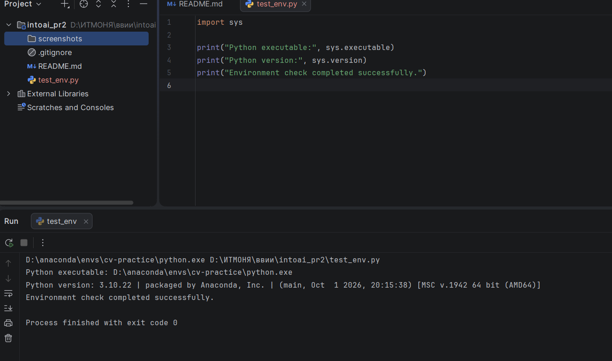
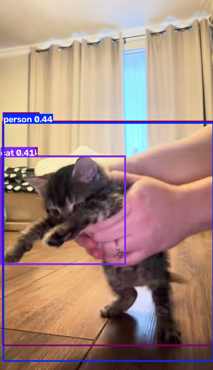
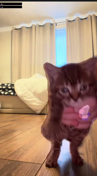

# Практическое занятие № 2

## Сведения о студенте

- ФИО: Соболева Елизавета 558200
- Группа: ЯМИИ 1.2

## Тема

Построение конвейера компьютерного зрения: детекция объектов и семантическая сегментация видеоряда.

## Цель работы

Освоить обработку видеоматериала с использованием предобученных моделей:
извлечение кадров, детекцию объектов, семантическую сегментацию,
визуализацию результатов и сборку анимированных GIF.

## 1. Использованные инструменты

- Windows.
- PyCharm.
- Conda-окружение `cv-practice`.
- Python 3.10.22.
- ffmpeg.
- PyTorch и torchvision.
- Ultralytics YOLOv8.
- OpenCV и Pillow.

Для детекции использована модель `YOLOv8n`.
Для семантической сегментации использована
`DeepLabV3-MobileNetV3-Large` с предобученными весами torchvision.

## 2. Настройка окружения

Создано отдельное окружение:

```text
conda create -n cv-practice python=3.10 -y
```

Интерпретатор проекта в PyCharm:

```text
D:\anaconda\envs\cv-practice\python.exe
```

Проверка интерпретатора выполнена скриптом `test_env.py`.
Скрипт завершился без ошибок, код завершения — 0.



Зависимости проекта перечислены в `requirements.txt`.

## 3. Подготовка видео и извлечение кадров

- Исходный файл: `video_input.mp4`.
- Источник видео: <собственная съёмка или ссылка на источник>.
- Содержание: <кратко опиши сцену>.
- Длительность: <число> секунд.
- Частота извлечения: 2 кадра в секунду.
- Получено кадров: <число>.

Извлечение реализовано в `extract_frames.py` с помощью ffmpeg.
Кадры сохранены в папку `frames` с последовательными именами
`frame_0001.jpg`, `frame_0002.jpg` и далее.

## 4. Детекция объектов

Скрипт: `run_detection.py`.

Для каждого кадра выполнен инференс модели YOLOv8n.
Использован порог confidence 0.25 и запуск на CPU.

В папку `det_results` сохранены:
- JPG с рамками, подписями классов и оценками уверенности;
- JSON с координатами рамок, классами и confidence.

На выбранном примере обнаружены: <перечисли фактические классы>.



Наблюдения:
<Опиши конкретный результат: что найдено правильно, что пропущено
или ошибочно выделено. Если явных ошибок на выбранном кадре не заметила,
так и напиши, не делая вывода об идеальной точности модели.>

## 5. Семантическая сегментация

Скрипт: `run_segmentation.py`.

Использована модель DeepLabV3-MobileNetV3-Large.
Для каждого пикселя выбирается класс с наибольшей оценкой модели.

В папку `seg_results` сохранены:
- JPG с цветными масками и легендой;
- PNG с картой номеров классов;
- JSON со списком присутствующих классов и количеством их пикселей;
- `classes.json` с названиями классов и цветами визуализации.

На выбранном примере выделены: <перечисли фактические классы>.



Наблюдения:
<Опиши качество границ масок, пропуски и ошибочные области.>

## 6. Создание GIF

Скрипт: `make_gifs.py`.

Созданы:
- `gifs/detection.gif` — результаты детекции;
- `gifs/segmentation.gif` — результаты семантической сегментации.

При частоте 2 кадра в секунду время показа кадра составляет 500 мс.
Обе GIF проверены: кадры сменяются в правильном порядке.

## 7. Сравнение результатов

Детекция показывает положение объектов с помощью прямоугольных рамок,
а также классы и оценки уверенности. Она не описывает точный силуэт объекта.
Семантическая сегментация присваивает классы пикселям и позволяет
визуализировать форму выделенных областей. При этом разные объекты одного
класса не получают отдельных идентификаторов.

В работе используются модели с разными наборами классов,
поэтому результаты нельзя напрямую считать сравнением точности двух
методов. DeepLabV3 с выбранными весами распознаёт 20 классов объектов
Pascal VOC и фон, а не все возможные категории сцены.


Скорость и потребление ресурсов количественно не измерялись.

## 8. Порядок воспроизведения

1. Установить ffmpeg и проверить `ffmpeg -version`.
2. Создать окружение с Python 3.10 и активировать его.
3. Установить зависимости:

   ```text
   python -m pip install -r requirements.txt
   ```

4. Поместить исходное видео в корень проекта как `video_input.mp4`.
5. Последовательно запустить:

   ```text
   python test_env.py
   python test_models.py
   python extract_frames.py
   python run_detection.py
   python run_segmentation.py
   python make_gifs.py
   ```

Для первого запуска моделей необходим интернет для загрузки весов.
Перед повторным извлечением кадров нужно перенести или удалить старые
файлы `frame_*.jpg` из папки `frames`.

## 9. Вывод

Реализован конвейер обработки видео:
извлечение кадров, детекция объектов, семантическая сегментация,
сохранение данных инференса и сборка двух GIF.
